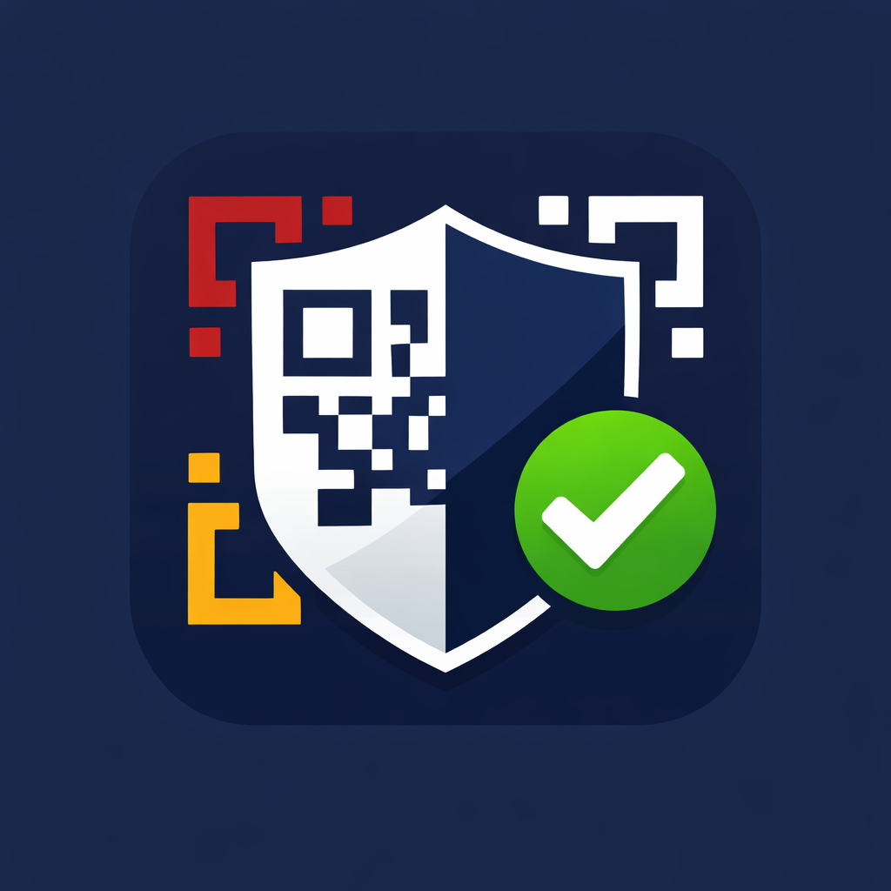
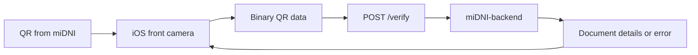

<p align="center">
  
</p>

<h1 align="center">miDNI-qr</h1>

<p align="center">
  A SwiftUI proof of concept for scanning Spain's DNIe data through miDNI QR codes.
</p>

<p align="center">
  
  
  
  <a href="LICENSE"></a>
</p>

<p align="center">
  <a href="#getting-started">Getting started</a> ·
  <a href="https://github.com/artcc/miDNI-backend">Backend</a> ·
  <a href="documentation/MiDNI-FormatoQR_v107_sc_PN.pdf">QR specification</a> ·
  <a href="CHANGELOG.md">Changelog</a>
</p>

## About the POC

**miDNI-qr is a proof of concept (POC) for scanning Spain's electronic identity document (DNIe) data**, shared through QR codes generated by the official **miDNI** app from Policía Nacional.

The iOS app reads a QR code with the front camera, sends its binary data to a backend for verification, and displays the returned document fields and photo, or an error with the option to scan again.

The complete POC consists of two repositories:

| Component | Repository | Responsibility |
| --- | --- | --- |
| iOS app | This repository | Camera capture, QR scanning, API requests, and result display |
| Backend | [artcc/miDNI-backend](https://github.com/artcc/miDNI-backend) | QR verification and decoded data returned to the app |

## Features

- **Live scanning** using the front camera and AVFoundation.
- **Binary QR capture** using Core Image's error-corrected codewords.
- **Backend integration** through `POST /verify` with bearer authentication.
- **Document details and photo** displayed from the verification response.
- **Age, simple, and complete profile fields** represented by optional response properties.
- **Loading, error, and scan-again states** for the complete demo flow.
- **Native implementation** with SwiftUI and Apple frameworks, without third-party dependencies.

## How it works



1. `ScannerView` displays the camera preview and starts `QRScannerController`.
2. The controller reads `CIQRCodeDescriptor.errorCorrectedPayload` and delivers it once per scan.
3. `MainViewModel` sends those bytes unchanged to the backend as a JSON array.
4. The backend response is decoded into `VerifyResponse`.
5. The app displays the returned fields when `valid` is `true`, or an error otherwise.

The transmitted bytes are the QR's **error-corrected codewords**. Their interpretation and the document verification belong to the backend side of this POC.

## Requirements

- **Xcode 26 or newer**, with Swift 6.2 support for the project's concurrency settings.
- **iOS 17.6 or newer**.
- A **physical iPhone with a front camera** for the scanning flow.
- A running instance of [miDNI-backend](https://github.com/artcc/miDNI-backend), reachable from the iPhone.
- A miDNI QR code displayed on another screen, or one of the examples in the included specification.

The simulator can be used to build the app, but camera scanning requires a physical device.

## Getting started

### 1. Set up the backend

Follow the setup instructions in **[artcc/miDNI-backend](https://github.com/artcc/miDNI-backend)** and obtain the API base URL and bearer token for your instance.

### 2. Configure the iOS app

Edit [`miDNI-qr/Configuration/BackendConfig.swift`](miDNI-qr/Configuration/BackendConfig.swift):

```swift
enum BackendConfig {
    static let baseURLString = "https://your-backend.example.com"
    static let bearerToken = "your-backend-token"
}
```

| Setting | Value |
| --- | --- |
| `baseURLString` | API base URL, without a trailing slash or `/verify` |
| `bearerToken` | Token expected by the backend, without the `Bearer ` prefix |

The app appends `/verify` to the base URL and adds the authentication header automatically. The committed values are placeholders to replace before running the POC.

### 3. Run and scan

1. Open `miDNI-qr.xcodeproj` in Xcode.
2. Select your development team in **Signing & Capabilities**, if needed.
3. Choose a physical iPhone as the run destination and run the app.
4. Grant camera access when prompted.
5. Present a miDNI QR code to the **front camera**.
6. Review the result and tap **Scan again** to repeat the flow.

## API contract

The app sends a request to the configured backend:

```http
POST /verify
Content-Type: application/json
Authorization: Bearer <token>
```

Example request body, with illustrative bytes:

```json
{
  "payloadBytes": [1, 2, 3]
}
```

The response is modeled by [`VerifyResponse.swift`](miDNI-qr/Models/VerifyResponse.swift):

| Field | Purpose |
| --- | --- |
| `valid` | Required boolean indicating the verification result |
| `reason` | Optional explanation when verification fails |
| Document fields | Optional identity, age, address, and expiry data, depending on the QR profile |
| `thumbnailBase64` | Optional Base64-encoded photo displayed alongside the fields |

See the [backend repository](https://github.com/artcc/miDNI-backend) for its implementation and setup details.

## Project structure

```text
miDNI-qr/
├── App/
│   └── app.swift
├── Configuration/
│   └── BackendConfig.swift
├── Features/
│   ├── Main/
│   │   ├── MainView.swift
│   │   └── MainViewModel.swift
│   ├── Scanner/
│   │   ├── CameraPreview.swift
│   │   ├── QRScannerController.swift
│   │   └── ScannerView.swift
│   └── Result/
│       └── ResponseView.swift
├── Models/
│   ├── VerifyRequest.swift
│   └── VerifyResponse.swift
├── Shared/Views/
│   ├── ErrorStateView.swift
│   └── LoadingView.swift
├── Assets.xcassets/
└── Info.plist
```

## Data flow

The camera is used for QR scanning. Captured QR bytes are sent to the configured backend, and the decoded response is held in the view model until the next scan is requested. The POC also displays the raw response on the result screen and prints backend responses to the debug console.

## Documentation and contributing

- [QR format and verification specification](documentation/MiDNI-FormatoQR_v107_sc_PN.pdf) — includes sample QR codes for valid, expired, and modified data scenarios.
- [Changelog](CHANGELOG.md) — version history.
- [Contributing](CONTRIBUTING.md) — development guidelines and manual testing flow.
- [Backend POC](https://github.com/artcc/miDNI-backend) — the companion project for end-to-end verification.

## License

Distributed under the **MIT License**. See [LICENSE](LICENSE).

## Author

[Arturo Carretero Calvo](https://github.com/artcc)
